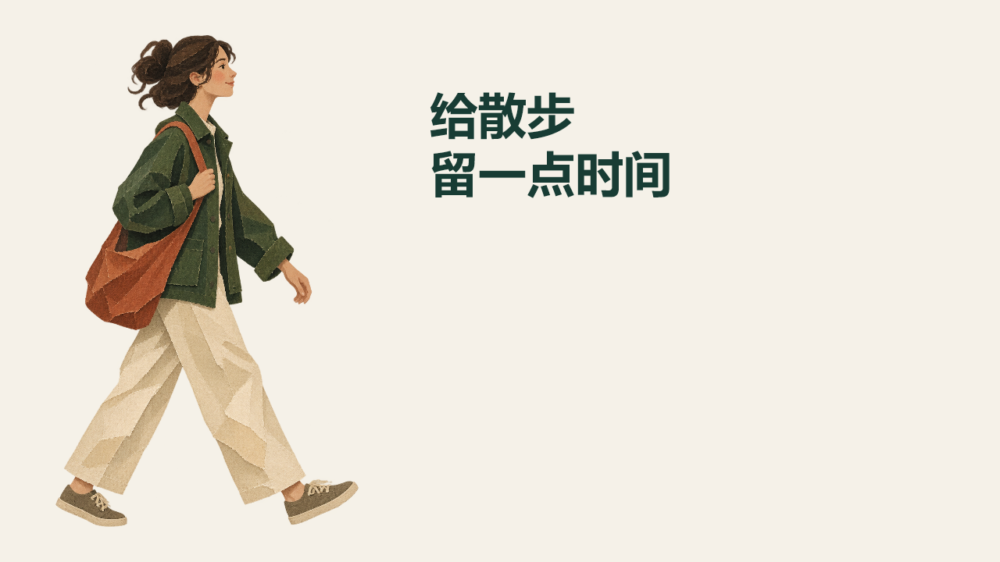
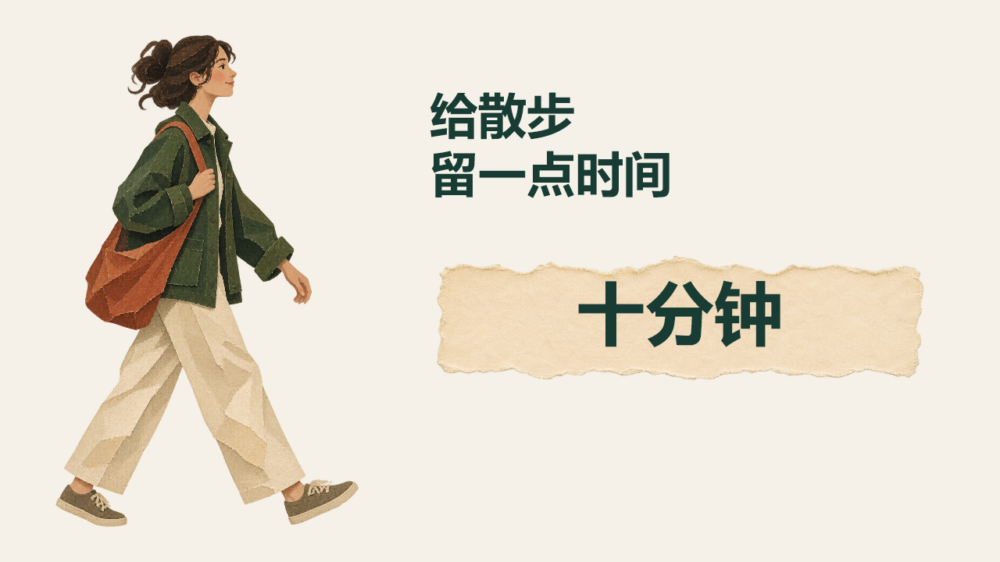
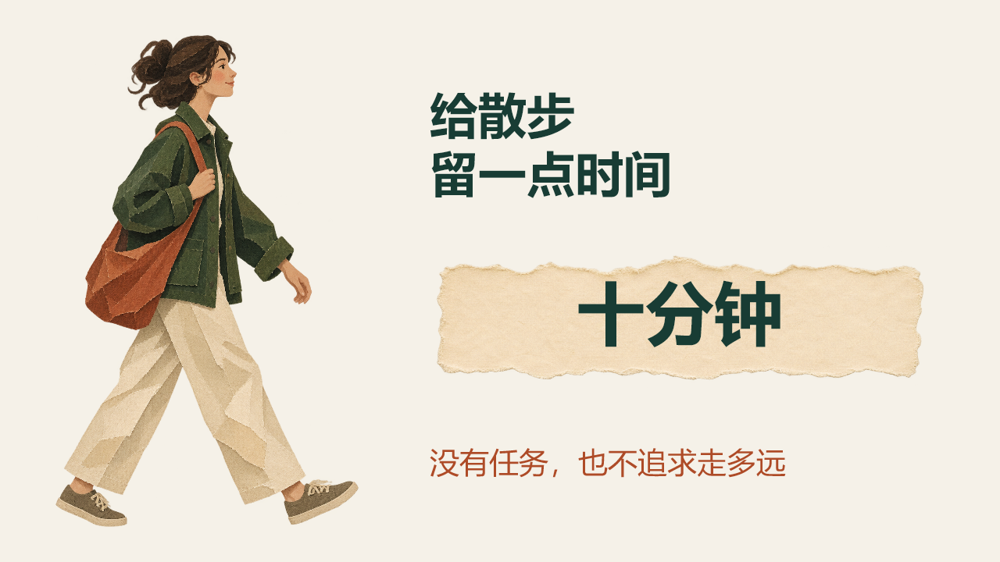
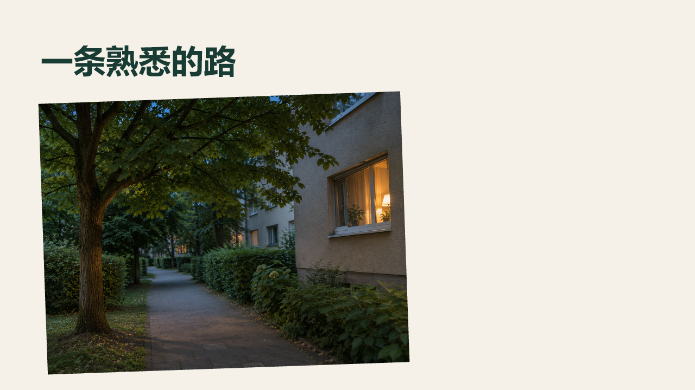
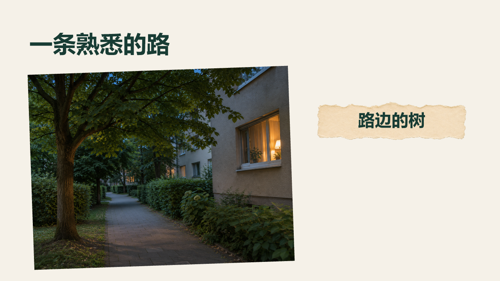
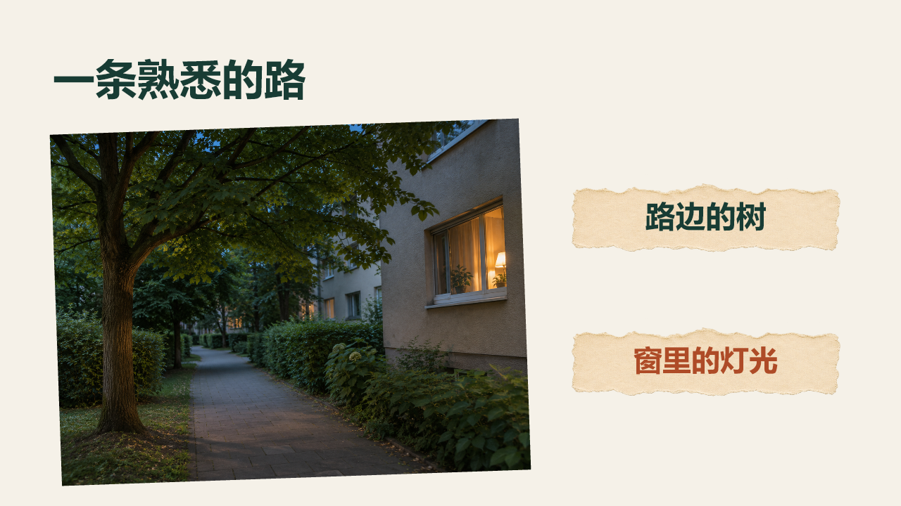
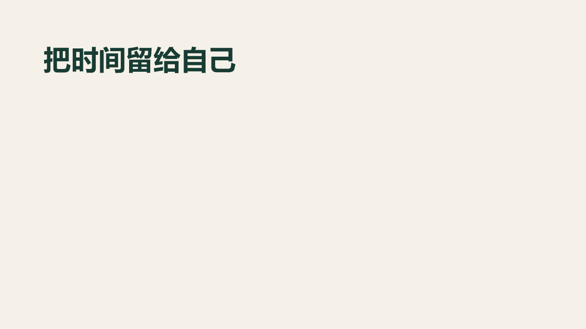
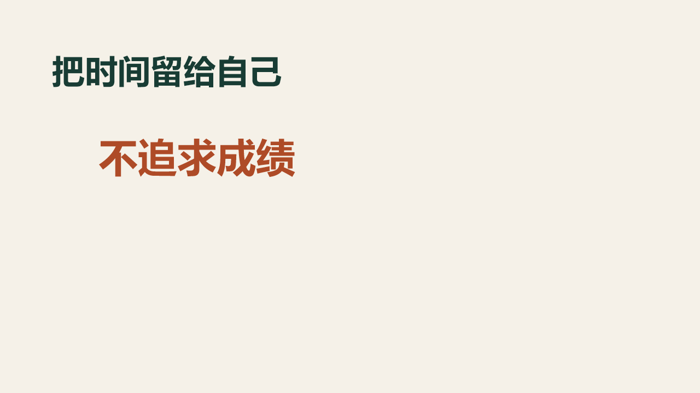
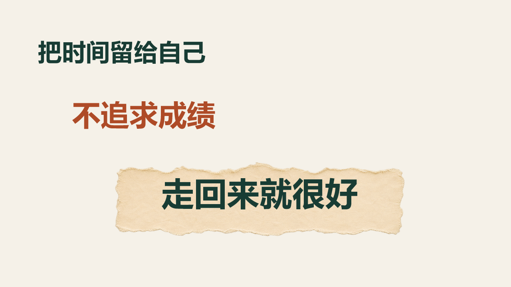

# 给散步留一点时间 · 拼贴示例：点击与讲稿提示

这些是静态累计状态；实际动画需在目标软件检查。

## 第 1 页 · 自动入场后

我曾经把一天排得很满。
走到地铁的路上也在回消息，吃完饭就接着看屏幕。

本次出现：title、walker

## 第 1 页 · 第 1 次点击后

后来，我想试着给自己留十分钟。

本次出现：ten-minutes

## 第 1 页 · 第 2 次点击后

没有任务，也不追求走多远，只是出门走一走。

本次出现：no-task

## 第 2 页 · 自动入场后

我选了一条离家很近的路。

本次出现：title、photo

## 第 2 页 · 第 1 次点击后

第一天，我看见路边一棵树。

本次出现：tree-label

## 第 2 页 · 第 2 次点击后

第二天，我注意到同一扇窗透出的灯光。路线没有变，我看到的东西却多了一点。我开始把注意力从手机收回来。

本次出现：light-label

## 第 3 页 · 自动入场后

这个小尝试没有替我解决所有问题。有些日子，我仍然很忙，也不想出门。

本次出现：title

## 第 3 页 · 第 1 次点击后

我想保留的，是可以暂时停下来的选择。今天的散步没有成绩。

本次出现：no-score

## 第 3 页 · 第 2 次点击后

走回来就很好。

本次出现：ending

